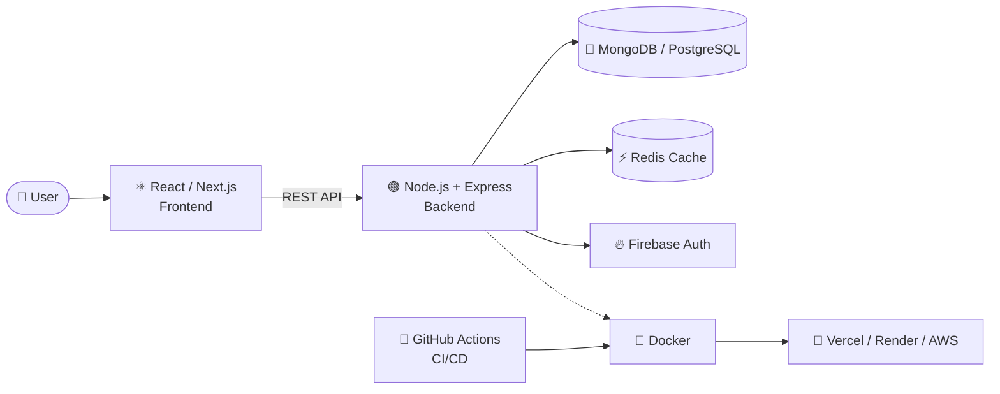
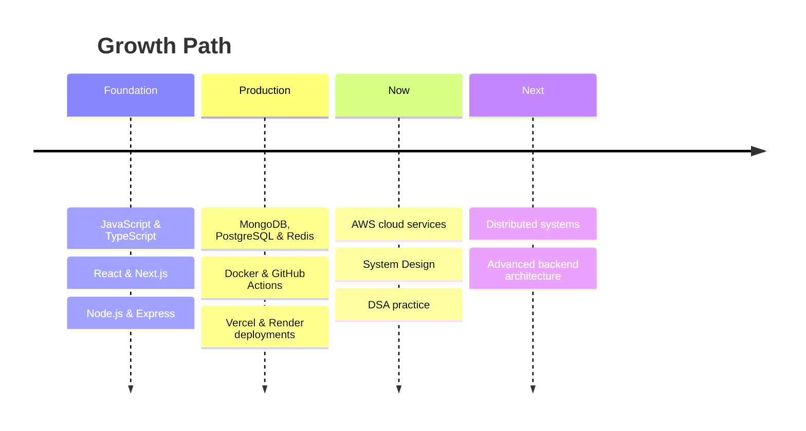

<div align="center">


<a href="https://git.io/typing-svg">
  
</a>

<br/>

<a href="https://vishalkukde.vercel.app/"></a>
<a href="https://www.linkedin.com/in/vishalkukde/"></a>
<a href="https://github.com/VishalKukde"></a>

<br/><br/>


</div>

---

## 👨‍💻 About Me

```js
const vishal = {
  role: "Full Stack Developer",
  location: "India 🇮🇳",
  specialization: ["MERN Stack", "REST APIs", "Scalable Web Apps"],
  currentlyLearning: ["AWS", "System Design"],
  practicing: "Data Structures & Algorithms",
  exploring: ["Cloud Technologies", "Backend Engineering"],
  mission: "Build fast, reliable and user-friendly products",
};
```

I'm a Full Stack Developer who enjoys building modern, scalable applications with JavaScript technologies, solving complex problems, and continuously learning new tools and architectures.

<table>
<tr>
<td width="50%" valign="top">

### 🔭 Currently Focused On
- ☁️ Cloud fundamentals with **AWS**
- 🏗️ **System Design** and scalable architecture
- 🧠 Daily **DSA** practice
- ⚙️ Backend performance, caching and CI/CD

</td>
<td width="50%" valign="top">

### 🎯 What I Bring
- Clean, maintainable, production-ready code
- End-to-end ownership, from UI to database
- Containerised, automated deployments
- Fast learner with a problem-solving mindset

</td>
</tr>
</table>

---

## 🛠️ Tech Arsenal

<div align="center">

| Domain | Technologies |
|:--|:--|
| **Frontend** |        |
| **Backend** |   |
| **Databases** |     |
| **DevOps & Cloud** |      |
| **Hosting** |   |
| **Core Concepts** |   |

</div>

---

## 🧩 How My Stack Fits Together



---

## 🚀 Featured Projects

<table>
<tr>
<td width="50%" valign="top">

### 🎬 [EpicShow](https://epicshow.vercel.app/)
Modern movie discovery platform with trending content, detailed movie information and a responsive experience.

      

[🔗 Live Demo](https://epicshow.vercel.app/)

</td>
<td width="50%" valign="top">

### 🍽️ [Dining & Delivery](https://dininganddelivery.vercel.app/)
Full-stack food ordering platform for restaurant discovery, menu browsing and order management.

    

[🔗 Live Demo](https://dininganddelivery.vercel.app/)

</td>
</tr>
<tr>
<td width="50%" valign="top">

### 📊 [Dining & Delivery Dashboard](https://dashboarddesktop.vercel.app/)
Administrative dashboard for managing restaurants, users, orders and delivery operations.

  

[🔗 Live Demo](https://dashboarddesktop.vercel.app/)

</td>
<td width="50%" valign="top">

### 🛍️ [Silk Street Shop](https://silkstreetshop.vercel.app/)
Modern e-commerce platform with authentication, product management, shopping cart and order processing.

  

[🔗 Live Demo](https://silkstreetshop.vercel.app/)

</td>
</tr>
</table>

---

## 🗺️ Learning Roadmap



---

## 📊 GitHub Analytics

<div align="center">


</div>

---

## 🤝 Let's Build Something Together

<div align="center">

I'm open to full-stack and backend opportunities, collaborations and interesting side projects.

<a href="https://www.linkedin.com/in/vishalkukde/"></a>
<a href="https://vishalkukde.vercel.app/"></a>

<br/><br/>

<i>"Building scalable web applications and continuously learning new technologies."</i>


</div>
